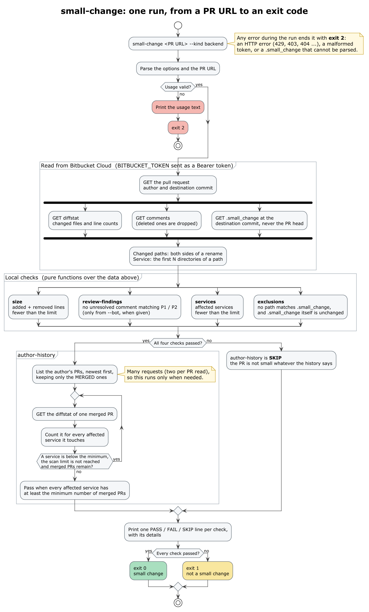

# small-change

Decides whether a Bitbucket Cloud pull request is a *small change*: small enough, and low-risk
enough, to skip a full review. It reads the PR through the Bitbucket API, checks five rules, prints
which ones hold, and exits with a code a pipeline can act on.

```sh
small-change https://bitbucket.org/team/platform/pull-requests/128 --kind backend
```

```
team/platform#128 "Round invoice totals to the currency's minor unit" by Alice

PASS  size             55 lines changed (must be fewer than 1000)
FAIL  review-findings  1 unresolved finding(s) matching /\bP[12]\b/i
      - #9 review-bot: **P2** Rounding differs for JPY
SKIP  author-history   not checked: another check already failed
PASS  services         2 affected service(s) (must be fewer than 3)
      - libs/money
      - services/billing
FAIL  exclusions       1 changed path(s) excluded
      - libs/money/index.ts (excluded by "libs/")

Result: not a small change
```

Exit code `0`: a small change. `1`: not a small change. `2`: usage error, or Bitbucket could not be
read.

The check itself calls no LLM. A separate `review` command can have an agent CLI you are already
logged in to (Claude Code, Cursor's `agent`, Codex, Pi, or Muse Code) review the PR and post findings that the
check then counts; see [Reviewing with an LLM](#reviewing-with-an-llm).

## How a run works



The diagram's source is [`docs/workflow.puml`](docs/workflow.puml).

## The rules

A PR is a small change only if **all** of these hold.

| Rule | Default | Options |
| --- | --- | --- |
| **size**: fewer than N lines changed, added plus removed | 1000 | `--max-lines` |
| **review-findings**: no unresolved P1 or P2 finding from the automated review | `\bP[12]\b`, any commenter | `--bot`, `--finding-pattern` |
| **author-history**: the author has merged at least N PRs in *each* affected service | 10 | `--min-merged`, `--history-limit` |
| **services**: fewer than N affected services | frontend 2 (one at most), backend 3 (two at most) | `--kind`, `--max-services`, `--service-depth` |
| **exclusions**: no changed path is listed in `.small_change` | none excluded | |

`--kind frontend|backend` picks the service limit of the monorepo; `--max-services <n>` sets it
directly. One of the two is required.

The author-history check reads many PRs, so it runs only when the other four pass. When one of
them fails, it is reported as `SKIP`: the PR is not a small change whatever the history says.

### Excluding paths: `.small_change`

Shared libraries and sensitive paths (anything that moves money, say) never qualify. List them in a
`.small_change` file at the repository root. It follows the core of `.gitignore` syntax:

```gitignore
# shared libraries
libs/
packages/design-system/

# money movement, wherever it sits in the tree
payments
**/ledger/**

# the root build files
/Makefile
*.lock
```

- `#` starts a comment; blank lines are ignored.
- A trailing `/` matches directories only. A pattern that names a directory covers everything under it.
- A pattern with a `/` at the start or in the middle is anchored to the repository root; one without
  matches at any depth.
- `*` and `?` stay within one path segment; `**` crosses segments.
- Negation (`!`) is refused with an error, because ignoring it would silently widen what counts as
  small.

The file is read from the **destination branch**, never from the PR, and a PR that changes
`.small_change` itself is never a small change. Otherwise a PR could lift its own exclusions.

## Install

Requires Node.js 24 or later.

```sh
git clone https://github.com/zereight/small-change.git
cd small-change
npm install
npm run build
node dist/cli.js --help
```

## Authentication

Set `BITBUCKET_TOKEN` to a token that can read the repository's pull requests and contents. It is
sent as a `Bearer` token to `api.bitbucket.org` only, and never printed. Bitbucket accepts Bearer
authentication for both kinds of token, so either works, and no email address is needed:

- an **access token** for the repository, project or workspace (scopes: pull requests read,
  repository read); this one has its own bot identity, separate from any person;
- an Atlassian account **API token** (scopes `read:pullrequest:bitbucket` and
  `read:repository:bitbucket`); this one acts as the account that owns it.

Bearer authentication has been tried against a private repository. If your token lives in another
variable, map it: `export BITBUCKET_TOKEN="$BITBUCKET_API_TOKEN"`.

Public repositories work without a token, but Bitbucket limits anonymous requests heavily (HTTP
429). One run makes about five requests, plus, for the author-history check, one per page of the
author's PR list and two for each PR it reads.

### Naming the review bot

`--bot` takes the name, nickname or UUID of whoever posts the review comments, and Bitbucket Cloud
has no separate "bot" object: the author is the identity of the token the automation uses. With an
access token it is the token's own bot identity; with a personal API token it is that person, so
their human comments would match too. In that case narrow `--finding-pattern` to the format only the
automation writes.

To see who commented on a PR, with their type, name and UUID:

```sh
curl -s -H "Authorization: Bearer $BITBUCKET_TOKEN" \
  "https://api.bitbucket.org/2.0/repositories/<workspace>/<repo>/pullrequests/<id>/comments?pagelen=100" \
  | node -e 'const d=JSON.parse(require("fs").readFileSync(0,"utf8"));for(const u of new Set(d.values.map(c=>[c.user.type,c.user.display_name,c.user.uuid].join("\t"))))console.log(u)'
```

The name is compared exactly (case and braces ignored). A name that matches nobody reads as "no
findings", so check the spelling.

## Reviewing with an LLM

`small-change review` has an agent CLI read the PR's diff and report problems, graded **P1** (must
fix), **P2** (should fix) and **P3** (minor). No API key is involved: it drives the CLI you are
logged in to, headless.

| Provider | CLI | Models | How the budget is applied |
| --- | --- | --- | --- |
| `claude` | `claude` | Cannot be listed; aliases are suggested (`opus`, `sonnet`, `haiku`, ...) | `--effort` |
| `cursor` | `agent` | `agent --list-models` | The effort is part of the model slug (`grok-4.7-xhigh`), so the budget swaps the slug |
| `codex` | `codex` | `codex debug models` | `-c model_reasoning_effort=...`, clamped to what the model supports |
| `pi` | `pi` | `pi --list-models` (extensions included), as `provider/model` | `--thinking`; a model without thinking gets no effort |
| `muse` | `muse` | Cannot be listed; `muse-spark-1.3` is suggested | `--reasoning-effort` |

### Choosing the model: `small-change model setup`

```sh
small-change model setup                # asks for provider, model and budget
small-change model setup --provider cursor --model grok-4.7-low --budget large --yes   # for a script
small-change model list                 # the models of every installed CLI
small-change model show                 # the saved choice
```

Setup detects the CLIs on PATH and their models, starts from the saved choice, applies the budget,
shows the result, and asks to confirm. Before saving, it sends a one-word request with the chosen
model, so a model the account rejects is never saved (`--no-verify` skips this). The file is
rewritten whole, so running setup again gives the same result.

| Budget | Effort |
| --- | --- |
| `unlimited` | max |
| `large` | xhigh |
| `medium` | high |
| `small` | medium |

When a model does not offer the effort, the highest one below it is used: `unlimited` on a model
that stops at `high` means `high`. Setup prints the slug or effort it ended up with.

The choice is saved in `$XDG_CONFIG_HOME/small-change/config.json`, else
`~/.config/small-change/config.json`; `--config <file>` overrides it for any `model` or `review`
command.

### Running a review

```sh
small-change review https://bitbucket.org/team/platform/pull-requests/128            # print findings
small-change review https://bitbucket.org/team/platform/pull-requests/128 --post     # and comment
```

`--post` posts each finding as a comment that opens with `**P1** <title>`, so the default
`--finding-pattern` of the check counts it. Name the posting identity in the check with `--bot`.
Posting needs `BITBUCKET_TOKEN` with write access to pull requests. A finding is skipped when a
comment on the PR already opens with the same line, so running the review twice does not post
twice. Other flags: `--language`, `--max-findings`, `--max-diff-bytes`, `--timeout`.

What keeps an untrusted PR from steering the review:

- The agent runs in an empty temporary directory with its tools off (Claude, Pi), read-only and in
  `ask` mode with a sandbox (Cursor), in a read-only sandbox (Codex), or with `--yolo` but shell,
  file writes, web tools and questions switched off in the bare `empty` preset (Muse). Pi also
  runs with skills, context files and MCP servers off. It is given the prompt only.
- Pi and Muse are the exception to "sandboxed". Pi runs as the local install is set up, so its
  extensions load, and Muse runs with `--yolo`, which turns off its approval prompts and sandbox.
  What holds them back is the tool-off flags, not a sandbox. One file read was tried on each, a
  file inside the workspace and one outside it: neither Pi (through `claude-bridge`) nor Muse read
  it. Two attempts are not proof that no tool call can get through.
- Its environment has no `BITBUCKET_*` variable, so it never holds the token that can comment.
  Posting is done by this tool, never by the agent.
- The title, description and diff sit between markers that are random on every run, and the agent
  is told they are data to review, not instructions. This lowers the risk; it does not remove it.
  An author can still word a diff to talk a model into reporting nothing, so a clean review is
  not proof that a PR is safe.
- Anything the agent writes is treated as text: `@` mentions and Markdown images are defused before
  posting, and each field is length-limited. An answer that is not the expected JSON posts nothing.
- A diff over `--max-diff-bytes` (default 300000) is refused, not cut: a review of part of a PR
  would read as a review of all of it.

Limits observed on a real machine:

- Codex's model catalog lists models that a ChatGPT login rejects (`model_not_found`). Setup's
  one-word request catches this and saves nothing. Every Codex model tried here was rejected, so a
  full Codex run has not been seen to succeed.
- Pi loads the local extensions, so `claude-bridge/*` models work. That provider starts Claude Code
  with `permissionMode: "bypassPermissions"` and does not ignore the user's own Claude settings, as
  the `claude` provider does: a plugin's note about its memory log showed up in one answer. Use
  `--provider claude` when a clean Claude run matters more than going through Pi.
- A model can be listed and still fail: `cursorapi/composer-2.5` was listed by Pi and answered
  `Connection error`, and the one-word request refused to save it.
- Muse has no command to list models and accepts any model id in `model-profile`, so only a
  request tells whether a model works: `muse-spark-1.3` did here, `muse-wonder-1.0` was refused
  for this account. Muse still loads the user's installed skills (115 here) into the run, even with
  the `empty` preset and without other tools' skills; the prompt is larger than it needs to be.
- For Cursor, a slug with no effort token (`gpt-5.3-codex`, `auto`, `composer-2.5`) is used as it
  is, whatever the budget.
- `--post` has not been run against a real PR.

## Choices to check

The rules leave room for interpretation. These are the choices made here; each is easy to change.

- **A service is a directory.** The first `--service-depth` directories of a path (default 2, so
  `services/payments`). A file at the repository root belongs to the service `.`, which counts as
  one.
- **The limits are "fewer than N".** That means `count < N`. Read literally with N = 1, a frontend
  PR would pass only when it touches no service, and an 8-line change to one file failed. So
  `--kind frontend` uses N = 2: one affected service is allowed. `--kind backend` keeps N = 3, so
  two are. `--max-services <n>` sets N directly.
- **Author history is per service.** The author's merged PRs are read newest first, one by one, and
  a PR counts for every affected service it touches. It stops when each service has enough, or after
  `--history-limit` PRs (default 100), in which case the check fails. The PRs are read one at a time,
  at about a second each, so 100 PRs take a couple of minutes.
- **Only unresolved findings count.** Without `--bot`, a comment from anyone that matches the
  pattern is a finding; `--bot` narrows that to the named review bots (name, nickname or UUID).
- **A renamed file counts on both sides**: its old and new path are both checked against the
  exclusions and both name a service.
- **Files that Bitbucket leaves out of a diff** by its own exclusion patterns (lock files, by
  default) count as zero lines.

## Not covered

- Bitbucket Data Center. Only `https://bitbucket.org/<workspace>/<repo>/pull-requests/<id>` URLs.
- Acting on the verdict: the tool reports, and the pipeline decides what to do with the exit code.
- Whether a PR from a fork can be read has not been verified.

## Development

```sh
npm test            # node --test, running the TypeScript sources directly
npm run typecheck
npm run build
```

The workflow diagram is PlantUML. After changing `docs/workflow.puml`, render it again with
`plantuml -tpng docs/workflow.puml` (Graphviz is required).

No runtime dependencies. The checks are pure functions over data (`src/checks.ts`); `src/bitbucket.ts`
is the only module that talks to Bitbucket, and `src/llm/` is the only one that starts the agent
CLIs.

## License

MIT
